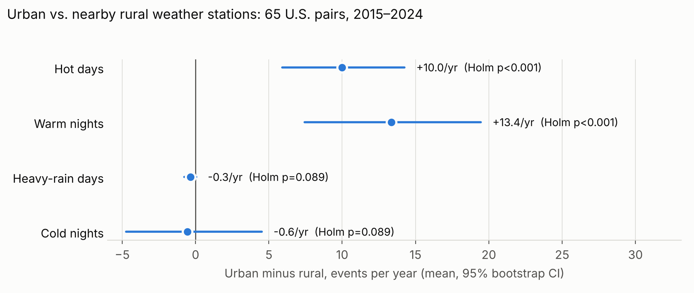

# Does Urbanization Change How Often Places Experience Extreme Weather?

DATA 703 final project · Ben Konigsberg · individual project

**Question.** Controlling for regional climate, do urban weather stations record extreme weather
more often than nearby rural stations?
**Audience.** Planners in small and mid-size cities deciding which weather hazards to prepare for.

## Findings at a glance



- Across 65 U.S. urban–rural station pairs (2015–2024), urban stations record about **13 more warm nights per year**
  than their rural partners, a result that holds across robustness checks.
- They also record about **10 more hot days per year**, but that result depends heavily on airport stations.
- There is **no clear urban effect on heavy rain** or cold nights, and **no evidence that nearby cities warm the rural
  stations** enough to bias the comparison.

**Full results, figures and the warm-nights ranking: [docs/RESULTS.md](docs/RESULTS.md)** (generated by the pipeline).

## Design

- **Paired stations.** 65 urban–rural pairs of NOAA GHCN-Daily stations, 2015–2024. Urban = inside a
  Census 2020 urban area; rural partner = outside every urban area, 20–75 km away, elevation within 100 m.
  The pair list is fixed and committed: [`config/final_pairs.csv`](config/final_pairs.csv).
- **Coverage.** A station-year counts only if both stations have ≥90% valid days for TMAX, TMIN and PRCP;
  a pair is kept with ≥8 usable years. Values carrying a GHCN quality flag are treated as missing.
- **Extreme events.** Thresholds come from each pair's **rural** station and apply to both stations:
  hot days (TMAX > rural 90th pct), warm nights (TMIN > rural 90th pct), heavy-rain days
  (PRCP > rural 95th pct of wet days), cold nights (TMIN < rural 10th pct; a negative control).
  Exceedance is strict: a value equal to the threshold is not an event. Rates are per 365 valid days.
- **Statistics.** Urban-minus-rural difference per pair; Wilcoxon signed-rank test, 95% bootstrap CI
  (seeded), Holm correction across the four indices.
- **Urban influence on the rural station.** A large city can warm its "rural" partner. Each rural station's
  distance outside the urban-area edge is measured from the Census boundaries, and a pair passes a
  size-scaled buffer when that distance is at least max(10 km, half the city's effective radius).
  The urban-influence check tests whether the urban–rural gap grows with that distance.
- **Other robustness flags.** Coastal mismatch (exactly one station within 25 km of the ocean; ocean mask from
  `global-land-mask`, which treats lakes as land) and airport urban stations. The main test is rerun on each subset.
- **Ranking.** Pairs passing the buffer and coast-matched are ranked by urban excess of warm nights, with a
  bootstrap CI across each pair's years. This ranks where urbanization currently adds the most warm nights in
  the sample; it is not a forecast.

## Setup

Requires Python ≥ 3.10. From the project root:

```bash
python3 -m venv .venv
source .venv/bin/activate          # Windows: .venv\Scripts\activate
python -m pip install -e ".[dev]"
```

## Run

```bash
python -m ewu.cli --config config/ewu.json                 # download what's missing, analyze, write the report
python -m ewu.cli --config config/ewu.json --stage fetch   # download only
python -m ewu.cli --config config/ewu.json --stage analyze # result tables from downloaded data
python -m ewu.cli --config config/ewu.json --stage report  # figures + docs/RESULTS.md from the tables
python -m ewu.cli --help
```

Settings resolve **command line > config file > defaults**. Every run logs the command, effective settings,
Git commit, counts and outputs to the terminal and `results/run.log`, and exits non-zero on failure.
Result tables go to `results/` (not committed): `results_overall.csv`, `pair_summary.csv` (with site flags),
`pair_year_differences.csv`, `robustness_tests.csv`, `urban_influence_check.csv`, `ranking_warm_nights.csv`.
`--stage report` turns them into figures and **`docs/RESULTS.md`, which are committed** so the findings are readable on
GitHub. They are generated output, kept in sync by rerunning the command, never edited by hand.

## Data and reproducibility

- Data is **not** committed. `--stage fetch` downloads it into `data/` (≈100 MB): NOAA station data via the
  [NCEI Access Data Service](https://www.ncei.noaa.gov/support/access-data-service-api-user-documentation),
  the GHCN station list, and the Census 2020 urban-area list and boundaries. Re-running skips finished files.
- [`data_manifest.csv`](data_manifest.csv) records each file's source URL, retrieval date and SHA-256.
  A fresh download that differs from the manifest is logged as a warning: **NOAA revises GHCN-Daily over
  time**, so a later download may not be byte-identical. The exact raw files analyzed are attached to the
  final GitHub release as a snapshot.
- TLS uses `certifi`, so downloads work on python.org macOS installs without extra setup.
- If you downloaded station data in a browser as `stations_part1.csv`…`stations_part3.csv`, place them in
  `data/`; the fetch stage splits them into per-station files.

## Tests

```bash
python -m pytest -q
```

Tests use small synthetic data and a fake downloader: no network, no real data.

## Project layout

```
ewu/core.py    pure rules: coverage, thresholds, event rates, pair differences
ewu/stats.py   pure statistics: bootstrap CI, Holm, paired summary
ewu/io.py      the only module touching network/files: downloads, manifest, readers, atomic writes
ewu/geo.py     pure geographic rules: urban-edge distance, size-scaled buffer, coast and airport flags
ewu/plots.py   figures (return matplotlib figures; io saves them)
ewu/report.py  builds docs/RESULTS.md from the result tables
ewu/cli.py     argparse, config precedence, logging, exit codes
config/        ewu.json settings and the committed pair list
docs/          generated results page and figures (committed)
tests/         pytest suite
```

Dependencies point one way: `cli → io → core/stats`.

## Results (reproduced Oct 15 from a fresh download)

65 pairs, 611 pair-years. Urban stations record **+13.4 warm nights/yr** (95% CI +7.4 to +19.5) and **+10.0 hot
days/yr** (+5.9 to +14.3) more than their rural partners (Holm p < 0.001 for both); no clear effect on heavy rain
or cold nights. The **urban-influence check finds no trend** of the gap with the rural station's distance from the
city (Spearman rho = −0.07, p = 0.59), and the warm-night effect holds for pairs beyond the size-scaled buffer
(+15.3/yr, n = 46), coast-matched pairs (+11.6/yr, n = 59) and non-airport urban stations (+12.3/yr, n = 30).
The hot-day effect does not survive excluding airports. With all three filters (n = 22) the warm-night estimate
stays positive (+8.8/yr) but is no longer significant.

## Limitations

- Many urban stations sit at airports; the hot-day signal is largely an airport effect.
- Single-pair rankings are sensitive to the chosen rural station's microclimate. The top of the warm-night
  ranking is dominated by Intermountain West pairs (Spokane, Provo–Orem, Idaho Falls, Salt Lake City), where cold
  air pooling in valleys at rural sites can widen the gap; terrain is not modelled.
- The coast flag uses ocean only; Great Lakes shores are not flagged.
- Ten years is too short to estimate trends; results describe 2015–2024, not the future.

## AI assistance

Claude Code (Anthropic) was used for scaffolding and drafting code; every change is reviewed, tested and
logged in [`AGENT_LOG.md`](AGENT_LOG.md). Agent-written commits are tagged `[agent]`.
