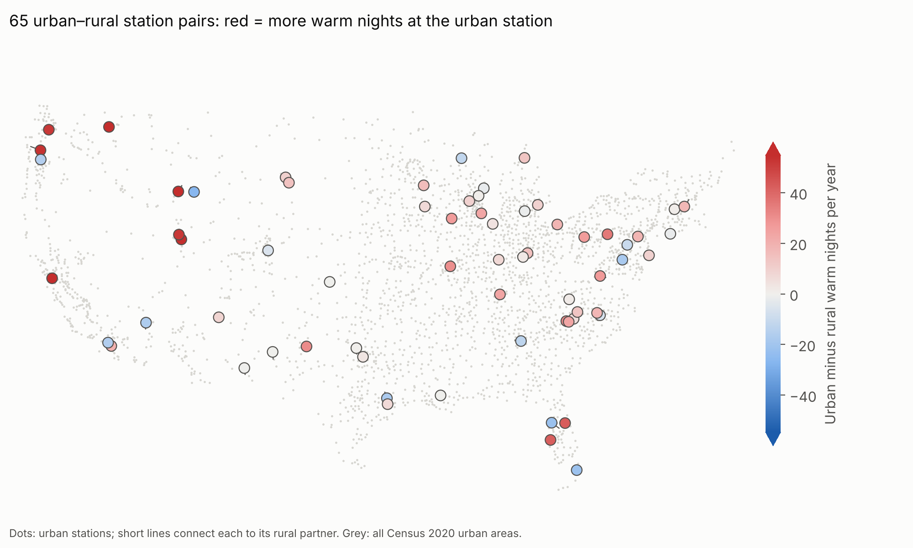
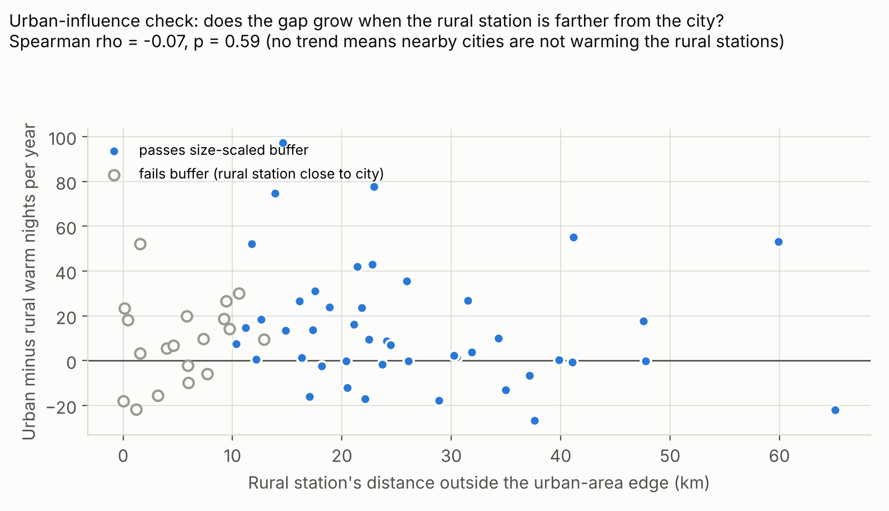
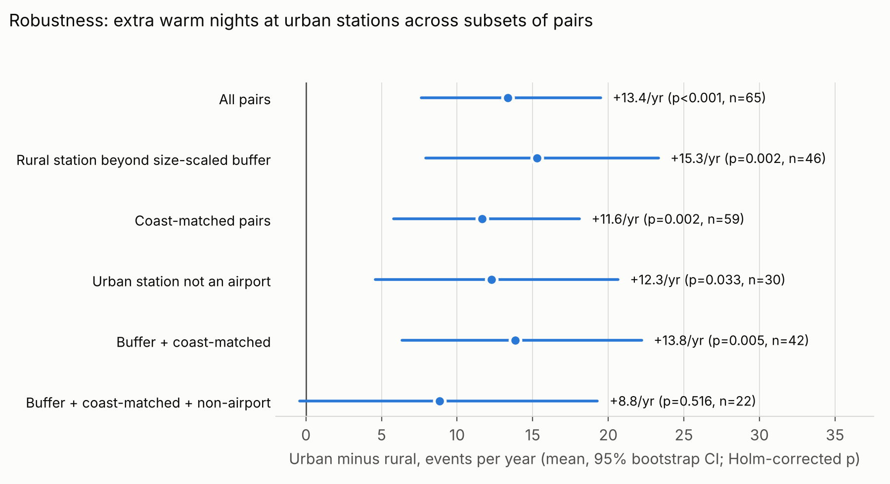
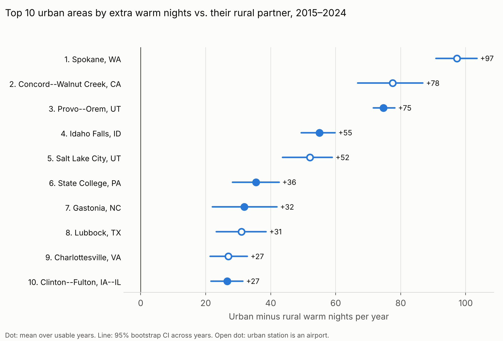

# Results: does urbanization change how often places experience extreme weather?

*Generated by `python -m ewu.cli --config config/ewu.json --stage report` on 2026-10-15 from commit `unknown`.
Every number on this page is computed from the pipeline's result tables; rerunning the pipeline regenerates it.*

**Design in one line:** 65 pairs of NOAA weather stations (611 station-pair-years, 2015–2024): one inside a Census
urban area, one rural partner 20–75 km away at similar elevation. Extreme-event thresholds come from the rural station and apply
to both, so the difference measures what the city adds.

## Key findings

- **Warm nights.** Urban stations recorded +13.4 warm nights per year (95% CI +7.4 to +19.5; Holm p < 0.001; urban higher in 69% of 65 pairs).
- **Hot days.** Urban stations recorded +10.0 hot days per year (95% CI +5.9 to +14.3; Holm p < 0.001; urban higher in 68% of 65 pairs). The effect largely disappears when the urban station is not an airport (+5.8/yr, Holm p = 0.985, n = 30), so much of it is an airport effect.
- **No clear urban effect** on heavy-rain days or cold nights (Holm p ≥ 0.05).
- **Urban influence on rural stations.** The gap in warm nights does not grow with the rural station's distance from the city (Spearman ρ = −0.07, p = 0.585), so there is no evidence that cities warm their rural partners enough to bias the comparison. 46 of 65 pairs pass the size-scaled buffer.
- **Robustness.** The effect on warm nights stays significant in 4 of 5 robustness subsets; in the strictest subset (buffer + coast-matched + non-airport, n = 22) it stays positive (+8.8/yr) but is not significant.
- **Largest urban excess of warm nights** among 42 vetted pairs: Spokane, WA, Concord--Walnut Creek, CA, Provo--Orem, UT (see the ranking below).

## 1. How much more often do cities see extremes?


| Index | Rural mean (days/yr) | Urban − rural (95% CI) | Median | Pairs urban higher | Holm p |
|:---|---:|---:|---:|---:|---:|
| Hot days | 32.8 | +10.0 (+5.9 to +14.3) | +7.2 | 68% | < 0.001 |
| Warm nights | 31.7 | +13.4 (+7.4 to +19.5) | +9.4 | 69% | < 0.001 |
| Heavy-rain days | 4.4 | −0.3 (−0.8 to +0.0) | −0.3 | 40% | 0.089 |
| Cold nights | 34.1 | −0.6 (−4.7 to +4.5) | −2.6 | 35% | 0.089 |

*Differences are events per year (per 365 valid days). CI: 95% bootstrap over pairs. p: Wilcoxon signed-rank test,
Holm-corrected across the four indices.*

## 2. Where the pairs are



## 3. Do large cities warm their rural partners?

Reviewers asked whether big cities heat the surrounding countryside enough to shrink the measured gap. If so, pairs whose
rural station sits just outside the city should show smaller gaps than pairs whose rural station is farther out.



Spearman ρ = −0.07 (p = 0.585): no relationship, so there is no sign that nearby cities are inflating rural temperatures.
A size-scaled buffer (rural station at least max(10 km, half the city's effective radius) outside the urban edge) keeps
46 of 65 pairs; results for that subset are in the next table.

## 4. Robustness

| Subset of pairs | Pairs | Warm nights: Δ/yr (Holm p) | Hot days: Δ/yr (Holm p) |
|:---|---:|---:|---:|
| All pairs | 65 | +13.4 (< 0.001) | +10.0 (< 0.001) |
| Rural station beyond size-scaled buffer | 46 | +15.3 (0.002) | +9.0 (0.003) |
| Coast-matched pairs | 59 | +11.6 (0.002) | +8.7 (< 0.001) |
| Urban station not an airport | 30 | +12.3 (0.033) | +5.8 (0.985) |
| Buffer + coast-matched | 42 | +13.8 (0.005) | +7.3 (0.017) |
| Buffer + coast-matched + non-airport | 22 | +8.8 (0.516) | +0.1 (1.000) |



*Coast-matched: excludes pairs where exactly one station is within 25 km of the ocean.
Non-airport: urban station is not at an airport.*

## 5. Where does urbanization add the most warm nights?

Ranking of the 42 pairs that pass the buffer and are coast-matched, by the urban excess of warm nights
(CI: 95% bootstrap across each pair's years).



| Rank | Urban area | Size | Extra warm nights/yr (95% CI) | Airport urban station |
|---:|:---|:---|---:|:---|
| 1 | Spokane, WA | 250k-1M | +97 (+91 to +103) | yes |
| 2 | Concord--Walnut Creek, CA | 250k-1M | +78 (+67 to +87) | yes |
| 3 | Provo--Orem, UT | 250k-1M | +75 (+72 to +78) | no |
| 4 | Idaho Falls, ID | 50k-250k | +55 (+49 to +60) | no |
| 5 | Salt Lake City, UT | >1M | +52 (+44 to +59) | yes |
| 6 | State College, PA | 50k-250k | +36 (+28 to +43) | no |
| 7 | Gastonia, NC | 50k-250k | +32 (+22 to +42) | no |
| 8 | Lubbock, TX | 250k-1M | +31 (+23 to +39) | yes |
| 9 | Charlottesville, VA | 50k-250k | +27 (+21 to +33) | yes |
| 10 | Clinton--Fulton, IA--IL | <50k | +27 (+22 to +31) | no |

**Read with care.** Each row is one pair of stations, so a ranking reflects that pair's specific sites as well as the city.
5 of the top 5 are in the mountain West, where cold air pooling in valleys at rural sites can widen night-time gaps;
terrain is not modelled. This ranks where urbanization adds the most warm nights today in this sample; it is not a forecast.

## Methods in brief

- **Data:** NOAA GHCN-Daily (TMAX, TMIN, PRCP), 2015–2024; Census 2020 urban areas (boundaries, population, density).
- **Coverage:** a station-year counts if both stations have ≥ 90% valid days for all three elements;
  pairs need ≥ 8 usable years. Values with a GHCN quality flag are treated as missing.
- **Events:** hot day = TMAX above the rural 90th percentile; warm night = TMIN above the rural 90th percentile;
  heavy-rain day = precipitation above the rural 95th percentile of wet days; cold night = TMIN below the rural 10th percentile.

## Limitations

- Many urban stations are at airports; the hot-day signal depends heavily on them.
- Terrain (valleys, cold-air pooling) is not modelled; the coast flag uses the ocean only (Great Lakes not flagged).
- 65 pairs is a sample, not every U.S. city; the strictest robustness subset is small.
- Ten years is too short to estimate trends: results describe 2015–2024, not the future.

## Reproduce

```bash
python -m pip install -e ".[dev]"
python -m ewu.cli --config config/ewu.json     # fetch, analyze, report
```
